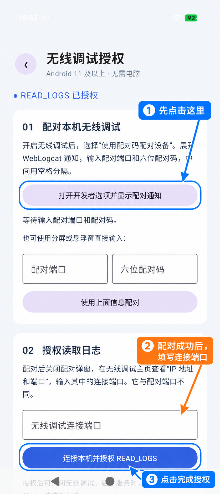
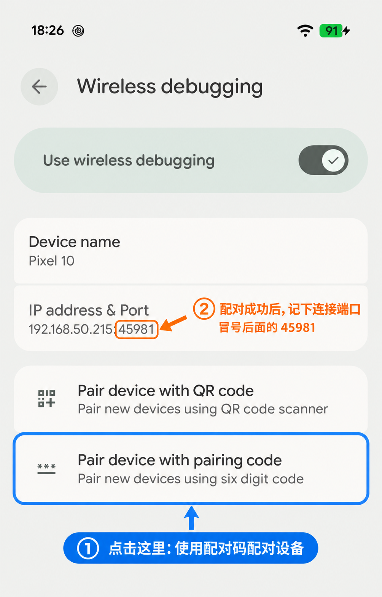
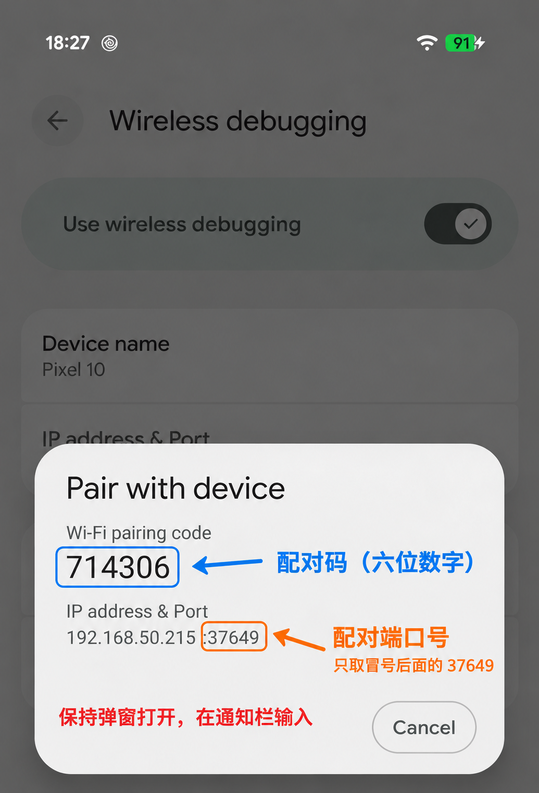
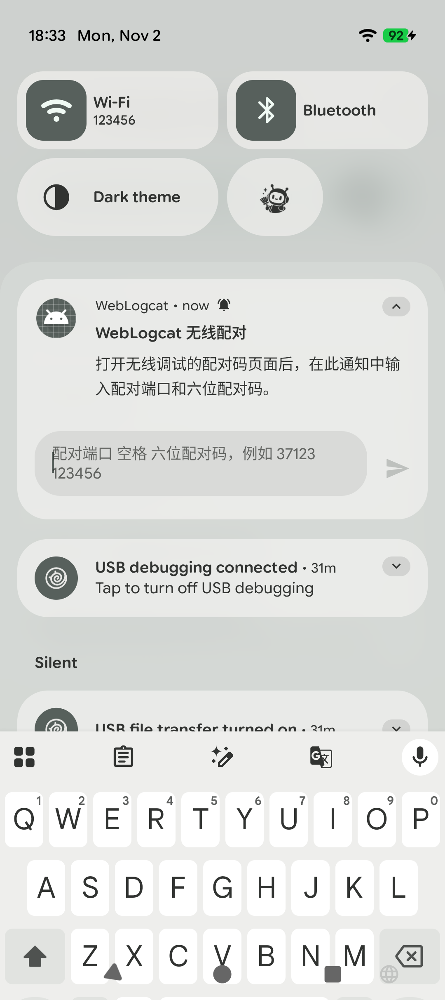
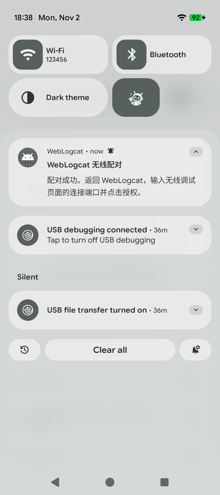

# WebLogcat

手机直接采集 Logcat 并提供局域网网页，无需保持电脑或 ADB 转发连接。

## 安装

从 [Releases](https://github.com/hzl000/weblogcat/releases) 下载 APK，在需要采集日志的手机上安装。自行构建时安装 `app/build/outputs/apk/debug/app-debug.apk`。

## 第一步：授权读取日志（Android 11 及以上，无需电脑）

下面从 WebLogcat 的 **“无线调试授权”页面**开始，一步一步操作。手机先连接 Wi-Fi；还没进入这个页面的话，打开 WebLogcat，点击 **设置 → 无线调试授权**。

> **最关键的一点：看到系统配对码弹窗后，不要关闭弹窗，也不要返回 WebLogcat。保持弹窗打开，直接下拉通知栏，在 WebLogcat 的通知里输入配对信息。只有提示“配对成功”后，才能关闭配对弹窗。**

下面使用 Pixel 10 真机截图，系统设置是英文，文中会给出对应中文。不同品牌界面可能不同；截图里的数字仅用于举例，操作时要用自己手机当前显示的数字。

### 1. 在无线调试授权页，点击“打开开发者选项并显示配对通知”



找到页面上半部分 **“01 配对本机无线调试”**，点击 **“打开开发者选项并显示配对通知”**。

如果手机询问是否允许 WebLogcat 发送通知，选择 **允许**。后面要用这条通知输入配对信息。

此时先不用填写页面里的“配对端口”“六位配对码”，按照下面的通知栏方式操作即可。截图设备已经授权，首次使用时你可能看到的是“READ_LOGS 尚未授权”，这是正常的。

如果还没有开启开发者选项：通常在系统 **设置 → 关于手机 → 版本号** 连续点击约 7 次，按提示输入锁屏密码。各品牌入口不同，可在系统设置中搜索。开启后，回到 WebLogcat 的无线调试授权页，再点一次上面的按钮。

### 2. 在系统设置里，打开“无线调试”

现在手机进入了系统的 **开发者选项（Developer options）**。

1. 向下找到 **无线调试（Wireless debugging）**。
2. 打开无线调试开关；如询问是否允许在当前 Wi-Fi 网络调试，选择允许。
3. 点击“无线调试”这一行，进入下面的详情页。



### 3. 点击“使用配对码配对设备”

在上图页面中，点击 **“使用配对码配对设备”**，英文是 **Pair device with pairing code**。不要选择上面的二维码配对。

手机会弹出下面这个窗口：



在这个**弹窗里面**找到两个数字：

| 看哪里 | 截图里是什么 | 你要记住什么 |
| --- | --- | --- |
| **Wi-Fi 配对码 / Wi-Fi pairing code** | `714306` | 这六位数字就是**配对码**。 |
| **IP 地址和端口 / IP address & Port** | `192.168.50.215:37649` | 只取冒号 `:` 后面的 **`37649`**，这就是**配对端口**。前面的 IP 地址不用输入。 |

> **停在这个弹窗，不要点“取消 / Cancel”，不要按返回键，不要切回 WebLogcat。关闭弹窗会使本次配对信息失效。接下来直接从屏幕顶部下拉通知栏。**

### 4. 弹窗保持打开，从屏幕顶部下拉通知栏

1. 手指从**屏幕最上边缘向下滑**，拉出通知栏。通知栏会盖在配对弹窗上面，**这不等于关闭弹窗**。
2. 找到标题为 **“WebLogcat 无线配对”** 的通知。
3. 如果通知折叠了，点击通知右侧的小箭头展开。
4. 点击通知里的 **“输入端口和配对码”**。**点这个按钮，不要点通知标题返回应用。**
5. 此时会在**通知内部**出现输入框和键盘，如下图。



如果忘了刚才的数字，可以先收起键盘和通知栏，查看下面仍然打开的配对弹窗，再下拉通知栏继续输入。**不要关闭配对弹窗。**

### 5. 在通知输入框填写“配对端口 空格 配对码”，然后发送

按这个顺序输入，两个数字中间按一次空格：

```text
配对端口 六位配对码
```

以上面的配对弹窗为例，应输入：

```text
37649 714306
```

也就是先输入 `37649`，按一下空格，再输入 `714306`，然后点击输入框**右侧的发送箭头**。

**不要输入 IP 地址、冒号或“配对端口”这几个汉字，也不要照抄通知输入框里的灰色提示数字。请使用自己当前配对弹窗里的数字。**

发送后，先留在通知栏等待结果。**“WebLogcat 无线配对”这条通知会更新为成功提示**，不需要返回应用查看：



看到通知里写着 **“配对成功。返回 WebLogcat，输入无线调试页面的连接端口并点击授权。”**，才说明这一步已经完成。在看到成功提示之前，下面的配对弹窗仍然要保持打开。

**配对成功还不等于授权完成。** 先按下一步到系统无线调试主页查看连接端口，再返回 WebLogcat 授权。

如果提示失败，先收起通知栏，检查配对弹窗中的当前数字，再下拉通知栏重试。如果弹窗已经关闭，需要重新点击“使用配对码配对设备”，用新弹窗里的配对端口和配对码重新输入。

### 6. 配对成功后，才关闭弹窗，查看另一个端口

**确认已经提示“配对成功”后**，收起通知栏。如果配对弹窗还在，此时才可以关闭它，回到系统的 **无线调试主页**。


找到主页的 **“IP 地址和端口 / IP address & Port”**。截图显示：

```text
192.168.50.215:45981
```

记下冒号后面的 **`45981`**，这个才是接下来要填写的 **连接端口**。

两个端口分别来自不同地方：

| 用途 | 从哪个页面读取 | 截图示例 |
| --- | --- | --- |
| 刚才在通知里配对 | **配对弹窗内**的“IP 地址和端口” | 配对端口 `37649` |
| 接下来返回应用授权 | **无线调试主页**的“IP 地址和端口” | 连接端口 `45981` |

**不要把刚才的配对端口 `37649` 再填一次。现在要重新看主页上的端口。保持无线调试开启。**

### 7. 返回 WebLogcat，输入连接端口并授权

1. 现在可以切回 WebLogcat，回到 **无线调试授权**页面。
2. 向下找到 **“02 授权读取日志”**。
3. 在 **“无线调试连接端口”** 中，只填写上一步从系统主页记下的端口。按截图举例，就是填 `45981`，不填 IP 地址和冒号。
4. 点击 **“连接本机并授权 READ_LOGS”**。
5. 等待完成，操作期间应用可能短暂关闭。确认页面显示 **“READ_LOGS 已授权”**，或返回首页确认未授权提示已经消失。

到这里才完成授权。可以关闭系统无线调试，然后按照下面的“第二步”启动日志服务。

### 遇到问题

| 现象 | 怎么处理 |
| --- | --- |
| 找不到无线调试 | 确认系统为 Android 11 及以上，已开启开发者选项并连接 Wi-Fi；不同品牌可在系统设置中搜索入口。 |
| 没有配对通知 | 先开启 WebLogcat 的通知权限，再回到无线调试授权页点击“打开开发者选项并显示配对通知”，然后重新打开系统配对弹窗，按步骤 3–5 操作。 |
| 配对失败 | 不要关闭配对弹窗，通过通知栏输入“配对端口 空格 配对码”。如果已经关掉弹窗，重新打开后使用新的配对信息。 |
| 配对成功，但授权失败 | 从无线调试**主页**重新读取连接端口，保持无线调试开启后重试。重新开启无线调试后应重新查看端口。部分厂商还有额外的 ADB 授权限制。 |
| 不知道是否要填 8765 | `8765` 是 WebLogcat 的默认**网页服务端口**，供浏览器访问日志使用，不是这一步的配对端口或连接端口。 |
| 卸载重装或撤销了权限 | 需要重新授权。 |

Android 无线调试的系统入口可参考 [Android 官方说明](https://developer.android.com/studio/run/device#wireless)。WebLogcat 使用本机无线调试完成自身授权，不需要额外的电脑或 Shizuku。

### 备用方式：通过电脑授权（也适用于 Android 10 及以下）

手机开启 USB 调试并连接装有 ADB 的电脑，在手机上确认允许该电脑调试，然后在电脑执行：

```sh
adb shell pm grant dev.weblogcat.probe android.permission.READ_LOGS
```

## 第二步：启动服务并打开网页

1. 返回 WebLogcat 首页，点击 **“启动服务”**。系统如弹出日志访问提示，选择一次性允许。应用确认能读取其他 UID 的 main 日志后，才会开启网页端口并显示二维码。
2. 让电脑或另一台设备与手机网络互通（通常连接同一个 Wi-Fi），扫描首页二维码，或在浏览器打开首页显示的访问链接。
3. 二维码包含当前 IP、网页服务端口和访问 token，仅在监听成功后出现。保持采集进程后可拔掉 USB；在手机点击 **“停止服务”** 可关闭监听和采集。

在“设置”中可调整**网页服务端口**（1024–65535，默认 `8765`）。端口设置会保存；运行中应用新端口只切换 HTTP 监听，保留采集会话，浏览器需使用新链接。端口占用会显示错误并保持原有监听，网络地址变化时二维码自动更新。

直接访问不含 token 的服务地址时，网页会显示授权页。在手机 WebLogcat 首页查看六位访问验证码，并在网页输入即可进入。**这里的访问验证码用于登录网页，与系统无线调试的配对码无关。** 验证码两分钟内有效、使用一次后立即更新，连续输错五次将暂时锁定；原有扫码链接仍可使用。

无线配对仅连接本机 Wi-Fi 地址，授权操作仅执行针对本应用的固定 `pm grant` 命令。配对码不写入持久存储；本机 ADB 私钥以 Android Keystore 中的密钥加密后存储在应用私有目录，并禁用应用备份。

## 网页

- 浅色、深色、跟随系统，保存主题选择；支持手机与电脑布局。
- 应用列表显示图标、名称、包名，支持搜索、多选和系统应用开关。默认隐藏系统应用。
- 显示时间、UID、PID、TID、等级、标签、包名及可获取的进程名。
- 查询字段、正则、排除、逻辑运算、时间、异常筛选，详见 [过滤说明](docs/filtering.md)。
- 自动补全字段及包名、标签、进程等已知值；查询历史和命名收藏。
- 暂停显示、恢复、跟随最新、清空当前视图、查看上下文；完整保留命中的堆栈组。
- 导出当前过滤结果或全部本地缓存，支持预览、下载与复制。全部缓存导出不受当前筛选条件影响。

过滤、暂停及清空不改变采集进程或其他客户端的视图。浏览器用增量游标获取日志，断开后自动重连，服务会话改变时重置游标。原始缓存超过 5 万条或估算 32 MB 后淘汰旧日志；当前过滤结果另有同样大小的保留预算，切换过滤条件会从现有原始缓存重新筛选。取消跟随时尽量保持当前阅读位置；日志本身被淘汰后无法继续定位。界面使用虚拟列表。字节预算按字段字符串及固定记录开销保守估算，不代表整个应用或浏览器的堆内存只有 32 MB。

应用使用 QUERY_ALL_PACKAGES 获取本机应用列表，仅向持有访问链接的客户端提供数据。应用图标按需加载，不依赖外部 CDN。

## 归属与系统限制

日志 UID 来自设备日志源。普通应用唯一 UID 映射到包名，多进程名称通过进程生命周期事件和可读取的进程信息补充；启动时读取保留的事件历史。共享 UID、隔离进程、历史已丢失或访问被限制时，不保证能获得唯一包名或进程名，显示未知，不猜测。

未授予 READ_LOGS 时，界面与服务入口都会拒绝启动，端口保持关闭。系统一次性授权未确认时会等待验证；如果 60 秒内未观察到其他 UID 的 main 日志，服务停止并提示重试。极少数设备日志空闲或系统行为不同，也可能触发这个保守超时。

READ_LOGS 的持久授权不等于永久的全设备日志会话。实测 Android 17 仍需前台系统确认；后台重建采集可能被拒绝，需要返回 APK 重新请求访问。设备 Logcat 本身也有缓冲与限流，不能保证突发高流量下所有源日志都完整保存。

## 构建与验证

```sh
./gradlew :app:assembleDebug
./gradlew :app:testDebugUnitTest :fixture:assembleDebug
node --test tests/*.test.cjs
```

应用包名在 `app/build.gradle.kts` 中配置。调试构建使用 Android 默认调试签名，SDK 路径在 `local.properties`。Android 代码使用 Kotlin 和 Jetpack Compose，目标 JVM 为 Java 17，compileSdk/targetSdk 36 和 minSdk 26。

`tests/fixture/` 是独立的日志测试源 APK，不打入产品 APK。可构建 `:fixture:assembleDebug` 验证主进程、远程进程、重启归属、等级和堆栈。`scripts/native_ui.py` 用最新 UI 节点定位端口控件；`scripts/stress_probe.py` 从调试设备读取当前服务配置，不硬编码访问 token。

本次功能验收见 [0.2 验证报告](evidence/RESULTS-v02.md)。早期 READ_LOGS 可行性验证保留在 [初始报告](evidence/RESULTS.md)。

## 自动构建与下载

推送到 `main` 后，GitHub Actions 会运行 Android 单元测试并编译 Debug APK。Release 使用 `app/build.gradle.kts` 中的 `versionName` 对应的固定标签（例如 `v0.3.1`）：同一版本的后续构建更新该 Release 的 APK、校验文件和说明；版本号变更后才创建新版本的 Release。也可在 Actions 中手动运行 `Build APK and publish Release`。固定标签指向该版本首次发布的提交，最新 APK 的源码提交以 Release 说明为准。

从 [Releases](https://github.com/hzl000/weblogcat/releases) 下载 APK 和 `SHA256SUMS.txt`。GitHub Actions 使用固定签名构建 Debug APK；首次从旧调试签名切换时需要卸载旧版本，卸载会清除应用数据。签名密钥需单独安全备份，不能提交到仓库。
